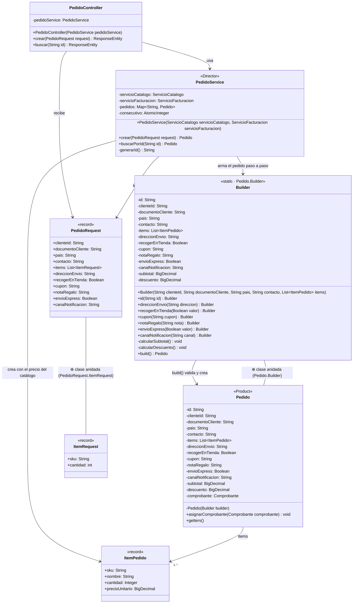
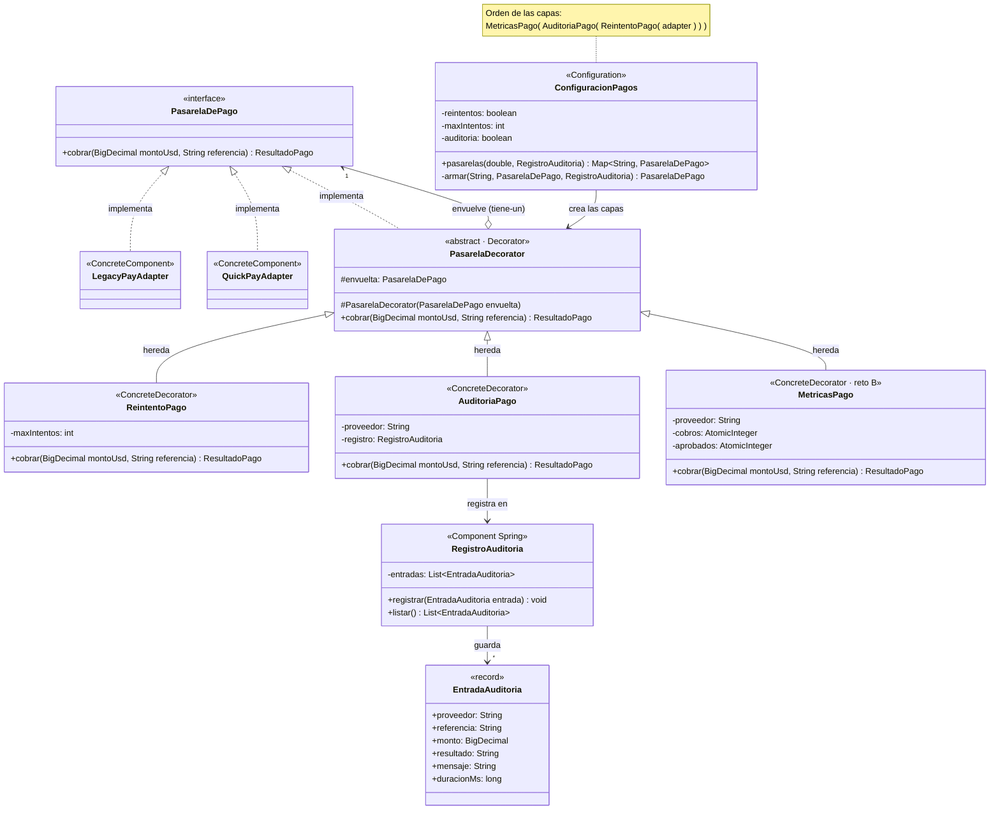

# ShopFlow

Ingeniería de Software 2 · Taller: patrones de diseño creacionales y estructurales en una API REST (Universidad El Bosque, 2026-2).

---

## 1. Integrantes, roles y ejecución del proyecto

### Integrantes y roles

| Rol | Integrante | Patrones | Reto de extensión |
|---|---|---|---|
| A | Maryory González Rendón | Builder → Abstract Factory | A · Perú (Abstract Factory) |
| B | Andrés Felipe González | Adapter → Decorator | B · Métricas (Decorator) |
| C | Juan David González | Proxy → Factory Method | C · WhatsApp (Factory Method) |

Integrador de las ramas: Andrés Felipe González

### Cómo ejecutar el proyecto

Requisitos: Java 17 o superior y Maven (o un IDE con soporte para Maven).

```bash
mvn spring-boot:run
```

La API queda disponible en `http://localhost:8080`.


## 2. Tabla de análisis de patrones (Anexo D)

| Patrón | Problema en ShopFlow (síntoma) | Participantes GoF → clases | Principio SOLID | Cuándo no usarlo |
|---|---|---|---|---|
| **Factory Method** | Al aprobar un pago se debe notificar usando el canal elegido. Crear la notificación con condicionales dentro de `PedidoService` acoplaría el flujo de pago a cada canal y obligaría a modificarlo al agregar WhatsApp. | **Product:** `Notificacion`.<br>**Concrete Products:** `NotificacionEmail`, `NotificacionSms`, `NotificacionWhatsApp`.<br>**Creator:** `Notificador` (`notificarPagoAprobado()` usa el producto creado).<br>**Concrete Creators:** `NotificadorEmail`, `NotificadorSms`, `NotificadorWhatsApp`.<br>**Client:** `PedidoService`. | **OCP:** un canal nuevo se agrega mediante un creador y producto concretos.<br>**DIP:** `PedidoService` recibe `List<Notificador>` y usa las abstracciones. | Cuando solo existe un canal estable: la jerarquía de creadores y productos agregaría más complejidad que crear directamente el único producto. |
| **Abstract Factory** | La facturación depende del país. Cada país tiene reglas distintas de impuestos, validación de identificación y comprobante. Con lógica condicional por país (`if`/`switch`), cada país nuevo obliga a modificar el servicio de facturación y se pueden mezclar reglas (por ejemplo, validar un pedido de México con reglas colombianas). | **Abstract Factory:** `FabricaFacturacion`.<br>**Concrete Factory:** `FabricaColombia`, `FabricaMexico`, `FabricaPeru`.<br>**Abstract Products:** `CalculadoraImpuestos`, `ValidadorIdentificacion`, `GeneradorComprobante`.<br>**Concrete Products:** `CalculadoraColombia`, `ValidadorColombia`, `GeneradorDIAN`; `CalculadoraMexico`, `ValidadorMexico`, `GeneradorCFDI`; `CalculadoraPeru`, `ValidadorPeru`, `GeneradorSUNAT`.<br>**Client:** `ServicioFacturacion`. | **OCP:** un país nuevo es una fábrica nueva, sin modificar `ServicioFacturacion`.<br>**DIP:** el servicio depende de la abstracción `FabricaFacturacion`, no de las clases de cada país. | Cuando no hay familias (un solo país) o cuando la familia cambia con frecuencia: agregar un producto nuevo a la familia obliga a modificar la interfaz y todas las fábricas concretas. |
| **Builder** | Un pedido tiene 4 datos obligatorios, al menos un ítem y 6 opciones (dirección, recoger en tienda, cupón, nota de regalo, envío express, canal de notificación), con reglas que dependen unas de otras. Un constructor largo permite confundir el orden de dos `String`; con setters, el pedido existe incompleto y puede quedar inválido. | **Builder:** `Pedido.Builder`.<br>**Product:** `Pedido` (inmutable, constructor privado).<br>**Director:** `PedidoService.crear()`, que traduce el JSON recibido a llamadas al builder. | **SRP:** el producto representa el pedido y el builder se encarga de construirlo y validarlo.<br>**OCP:** agregar una opción nueva no obliga a crear más constructores. | Para objetos con dos o tres parámetros, todos obligatorios: el builder duplica código sin aportar nada y hay que mantenerlo cada vez que cambian los atributos. |
| **Adapter** | Dos proveedores con SDK que no se pueden modificar y no coinciden entre sí ni con ShopFlow. Sin patrón, centavos, códigos "00…" y enums quedarían regados por la lógica de negocio. | **Target:** `PasarelaDePago`.<br>**Adapters:** `LegacyPayAdapter`, `QuickPayAdapter`.<br>**Adaptees:** `LegacyPayClient`, `QuickPaySdk`.<br>**Client:** `PedidoService`. | **DIP:** el dominio depende de `PasarelaDePago`, una abstracción propia, y no del SDK.<br>**SRP:** la traducción de montos, respuestas y excepciones vive en una sola clase por proveedor.<br>**OCP:** un proveedor nuevo es un adapter nuevo, sin tocar `PedidoService`. | Cuando se controlan ambas interfaces: es más simple alinearlas. Y cuando la intención es simplificar un subsistema completo: eso es Facade. |
| **Decorator** | LegacyPay falla con timeout el 30 % de las veces, así que conviene reintentar; auditoría exige registrar cada cobro de los dos proveedores, y en pruebas los reintentos deben poder apagarse. Con herencia harían falta seis subclases (dos proveedores por tres combinaciones, como `LegacyPayConReintentoYAuditoria`), y cada capa nueva duplicaría la cuenta. | **Component:** `PasarelaDePago`.<br>**Concrete Component:** `LegacyPayAdapter`, `QuickPayAdapter`.<br>**Decorator:** `PasarelaDecorator` (abstracta).<br>**Concrete Decorators:** `ReintentoPago`, `AuditoriaPago`, `MetricasPago`. | **OCP:** una capa nueva es una clase nueva; solo se toca `ConfiguracionPagos` para agregarla.<br>**SRP:** cada decorador hace una sola cosa (reintentar, auditar o medir).<br>**LSP:** una pasarela decorada se usa donde se espera cualquier `PasarelaDePago`. | Cuando las combinaciones son pocas y fijas (dos subclases bastan), cuando el cliente depende de los tipos concretos, o cuando una capa necesita saber qué otras capas hay en la cadena. Muchas capas dificultan la depuración. |
| **Proxy** | `CatalogoRemoto` tarda 1,5 s por llamada y el cambio de precios requiere rol ADMIN. Sin intermediarios, se repetiría la consulta costosa y cada controlador tendría que imponer su propia autorización. | **Subject:** `ServicioCatalogo`.<br>**Real Subject:** `CatalogoRemoto`.<br>**Cache Proxy:** `CatalogoCacheProxy`.<br>**Protection Proxy:** `CatalogoProteccionProxy`.<br>**Client:** `PedidoService` y `ProductoController`; la configuración publica la caché como `ServicioCatalogo`. | **SRP:** caché y autorización quedan fuera del catálogo remoto.<br>**OCP/LSP:** los proxies se pueden usar como `ServicioCatalogo` y no alteran el objeto real. | Cuando el objeto es local y barato, la indirección y el estado de caché no compensan su costo; tampoco debe usarse para agregar funciones ajenas al control de acceso, que corresponden a Decorator. |

---

## 3. Patrones implementados

### 3.1 Builder

#### Problema que resuelve

Un pedido tiene datos obligatorios (cliente, país, documento, contacto y al menos un ítem) y muchas opciones. Varias reglas dependen de más de una opción a la vez:

- La dirección es obligatoria si el pedido no se recoge en tienda.
- Un pedido para recoger en tienda no puede ser express.
- La nota de regalo admite máximo 140 caracteres.

Con un constructor largo es fácil invertir dos `String`; con setters, el pedido existe incompleto mientras se arma y nadie garantiza las reglas. `Pedido.Builder` concentra todas las validaciones en `build()`, por lo que nunca se entrega un pedido inválido.

#### Participantes GoF

| Participante | Clase | Responsabilidad |
|---|---|---|
| Builder | `Pedido.Builder` | Recibe los datos obligatorios en su constructor, ofrece un método por cada opción (interfaz fluida) y valida en `build()`. |
| Product | `Pedido` | Objeto inmutable: atributos `final`, constructor privado y sin setters. |
| Director | `PedidoService.crear()` | Traduce el `PedidoRequest` recibido a llamadas al builder. |

`ItemPedido` es un `record` (sku, nombre, cantidad y precio unitario). El precio se toma del catálogo, no del cliente. El cupón de prueba `BOSQUE10` aplica 10 % de descuento sobre el subtotal.
#### Diagrama de clases
 

 
**Notación:** `───>` usa o crea · `── ⊕ clase anidada`: la clase de abajo está dentro de la de arriba (`Pedido.Builder`, `PedidoRequest.ItemRequest`).
 
---
#### Endpoint que lo evidencia

```
POST /api/pedidos
GET  /api/pedidos/{id}
```

Ejemplo de petición:

```json
{
  "clienteId": "CLI-001",
  "documentoCliente": "1020304050",
  "pais": "CO",
  "contacto": "ana.perez@correo.com",
  "items": [
    { "sku": "SKU-001", "cantidad": 1 },
    { "sku": "SKU-002", "cantidad": 2 }
  ],
  "direccionEnvio": "Calle 134 # 9-51, Bogotá",
  "cupon": "BOSQUE10",
  "envioExpress": true,
  "canalNotificacion": "EMAIL"
}
```

Respuestas relevantes:

| Caso | Respuesta |
|---|---|
| Pedido válido | `201 Created` con el pedido y el descuento del cupón |
| Pedido sin ítems | `400` con mensaje claro |
| Domicilio sin dirección | `400` con mensaje claro |
| Recoger en tienda y express a la vez | `400` con mensaje claro |
| Nota de regalo de más de 140 caracteres | `400` |
| SKU inexistente | `404` |

Prueba unitaria: `PedidoBuilderTest` (`src/test/java/co/edu/unbosque/shopflow/`).

---

### 3.2 Abstract Factory

#### Problema que resuelve

Cada país exige una **familia** de piezas que deben ir juntas:

- Calculadora de impuestos.
- Validador de identificación del cliente.
- Generador del comprobante electrónico.

Sin el patrón, `ServicioFacturacion` tendría un `if (pais.equals("CO"))` repetido, sería fácil mezclar el impuesto de un país con el comprobante de otro, y abrir Perú obligaría a editar cada `if`. Con Abstract Factory el servicio recibe `List<FabricaFacturacion>`, arma un mapa por país y factura sin conocer ninguna clase concreta.

| País | Impuesto | Documento del cliente | Comprobante |
|---|---|---|---|
| Colombia (`CO`) | IVA 19 % | Cédula o NIT (6 a 10 dígitos) | Factura electrónica (DIAN) |
| México (`MX`) | IVA 16 % | RFC | CFDI (SAT) |
| Perú (`PE`) | IGV 18 % | RUC de 11 dígitos (el validador también acepta 8 dígitos) | Factura electrónica (SUNAT) |

> Las tarifas y formatos de documento son valores de referencia para el ejercicio, no asesoría tributaria.

#### Participantes GoF

| Participante | Clases |
|---|---|
| Abstract Factory | `FabricaFacturacion` (`pais()`, `crearCalculadora()`, `crearValidador()`, `crearGenerador()`) |
| Concrete Factory | `FabricaColombia`, `FabricaMexico`, `FabricaPeru` (todas `@Component`) |
| Abstract Products | `CalculadoraImpuestos`, `ValidadorIdentificacion`, `GeneradorComprobante` (y el `record Comprobante`) |
| Concrete Products | Colombia: `CalculadoraColombia`, `ValidadorColombia`, `GeneradorDIAN`<br>México: `CalculadoraMexico`, `ValidadorMexico`, `GeneradorCFDI`<br>Perú: `CalculadoraPeru`, `ValidadorPeru`, `GeneradorSUNAT` |
| Client | `ServicioFacturacion` |

#### Diagrama de clases


 
```mermaid
classDiagram
    direction TB
    class ServicioFacturacion {
        <<Client>>
        -fabricas: Map~String, FabricaFacturacion~
        +ServicioFacturacion(List~FabricaFacturacion~ listaFabricas)
        +facturar(String pais, String documento, String cliente, BigDecimal subtotal) Comprobante
    }
    class FabricaFacturacion {
        <<interface · AbstractFactory>>
        +pais() String
        +crearCalculadora() CalculadoraImpuestos
        +crearValidador() ValidadorIdentificacion
        +crearGenerador() GeneradorComprobante
    }
    class CalculadoraImpuestos {
        <<interface · AbstractProduct>>
        +calcular(BigDecimal subtotal) BigDecimal
    }
    class ValidadorIdentificacion {
        <<interface · AbstractProduct>>
        +validar(String documento) boolean
    }
    class GeneradorComprobante {
        <<interface · AbstractProduct>>
        +generar(String cliente, BigDecimal subtotal, BigDecimal impuesto) Comprobante
    }
    class Comprobante {
        <<record>>
        +tipo: String
        +descripcion: String
        +subtotal: BigDecimal
        +impuesto: BigDecimal
        +total: BigDecimal
        +porcentajeIVA: BigDecimal
    }
    namespace colombia {
        class FabricaColombia {
            <<ConcreteFactory>>
        }
        class CalculadoraColombia
        class ValidadorColombia
        class GeneradorDIAN
    }
    namespace mexico {
        class FabricaMexico {
            <<ConcreteFactory>>
        }
        class CalculadoraMexico
        class ValidadorMexico
        class GeneradorCFDI
    }
    namespace peru_reto_A {
        class FabricaPeru {
            <<ConcreteFactory>>
        }
        class CalculadoraPeru
        class ValidadorPeru
        class GeneradorSUNAT
    }
 
    ServicioFacturacion --> "*" FabricaFacturacion : usa
    ServicioFacturacion --> CalculadoraImpuestos : usa
    ServicioFacturacion --> ValidadorIdentificacion : usa
    ServicioFacturacion --> GeneradorComprobante : usa
    GeneradorComprobante --> Comprobante : crea
 
    FabricaFacturacion <|.. FabricaColombia
    FabricaFacturacion <|.. FabricaMexico
    FabricaFacturacion <|.. FabricaPeru
    CalculadoraImpuestos <|.. CalculadoraColombia
    CalculadoraImpuestos <|.. CalculadoraMexico
    CalculadoraImpuestos <|.. CalculadoraPeru
    ValidadorIdentificacion <|.. ValidadorColombia
    ValidadorIdentificacion <|.. ValidadorMexico
    ValidadorIdentificacion <|.. ValidadorPeru
    GeneradorComprobante <|.. GeneradorDIAN
    GeneradorComprobante <|.. GeneradorCFDI
    GeneradorComprobante <|.. GeneradorSUNAT
 
    FabricaColombia --> CalculadoraColombia : crea
    FabricaColombia --> ValidadorColombia : crea
    FabricaColombia --> GeneradorDIAN : crea
    FabricaMexico --> CalculadoraMexico : crea
    FabricaMexico --> ValidadorMexico : crea
    FabricaMexico --> GeneradorCFDI : crea
    FabricaPeru --> CalculadoraPeru : crea
    FabricaPeru --> ValidadorPeru : crea
    FabricaPeru --> GeneradorSUNAT : crea
```

**Notación:** `- - -▷` implementa · `───>` usa o crea. Cada recuadro es una familia: la fábrica de un país solo crea productos de ese país. `ServicioFacturacion` no tiene flechas a ninguna clase de un país: solo conoce las interfaces.
#### Endpoint que lo evidencia

El comprobante se incluye en la respuesta de:

```
POST /api/pedidos
```

El país se indica con su código en el campo `pais` (`CO`, `MX` o `PE`).

| Pedido | Resultado |
|---|---|
| `"pais": "CO"` con cédula `1020304050` | Factura electrónica (DIAN), IVA 19 % |
| `"pais": "MX"` con RFC `GODE561231GR8` | CFDI (SAT), IVA 16 % |
| `"pais": "MX"` con la cédula colombiana `1020304050` | `400` (documento inválido para MX) |
| `"pais": "PE"` con RUC de 11 dígitos | Factura electrónica (SUNAT), IGV 18 % |

Prueba unitaria: `ServicioFacturacionTest` (`src/test/java/co/edu/unbosque/shopflow/`).

---

### 3.3 Adapter

#### Problema que resuelve
 
ShopFlow cobra con dos proveedores cuyos SDK (paquete `externos`) no se pueden modificar y hablan "idiomas" distintos:
 
| | LegacyPay (`LegacyPayClient`) | QuickPay (`QuickPaySdk`) | ShopFlow (`PasarelaDePago`) |
|---|---|---|---|
| Monto | `long` en centavos | `double` en dólares | `BigDecimal` en dólares |
| Respuesta | Texto `"código\|autorización"` (`00` aprobado, `51` fondos insuficientes, otro = no permitida) | Enum `QuickPayStatus` (`OK`, `REJECTED`, `ERROR`) | `ResultadoPago` |
| Fallo | `LegacyPayTimeoutException` | — | `PasarelaNoDisponibleException` |
 
Sin el patrón, `PedidoService` tendría que multiplicar por 100, partir el texto por `|`, revisar el enum y capturar la excepción del SDK. Cambiar de proveedor obligaría a reescribir la lógica de negocio. Con Adapter, cada proveedor tiene una clase que traduce su SDK a `PasarelaDePago`, y **ninguna clase fuera de los adapters importa algo del paquete `externos`**.
 
#### Participantes GoF
 
| Participante | Clase | Responsabilidad |
|---|---|---|
| Target | `PasarelaDePago` | Interfaz propia de ShopFlow: `cobrar(BigDecimal montoUsd, String referencia)`. |
| Adapter | `LegacyPayAdapter` | Guarda un `LegacyPayClient` (composición), convierte dólares a centavos, interpreta `"código\|autorización"` y traduce `LegacyPayTimeoutException` a `PasarelaNoDisponibleException`. |
| Adapter | `QuickPayAdapter` | Guarda un `QuickPaySdk`, convierte `BigDecimal` a `double` y traduce `OK`, `REJECTED` y `ERROR` a un `ResultadoPago`. |
| Adaptee | `LegacyPayClient`, `QuickPaySdk` | SDK de terceros (no se modifican). |
| Client | `PedidoService` | Cobra a través de `PasarelaDePago` sin saber qué proveedor hay detrás. |
 
Es un **adaptador de objeto** (usa composición, no herencia), la variante recomendada por GoF y Head First.
 
#### Diagrama de clases
 ```mermaid
classDiagram
    direction TB
    class PedidoService {
        <<Client>>
        -pasarelas: Map~String, PasarelaDePago~
        +pagar(String id, String proveedor) Pedido
    }
    class PasarelaDePago {
        <<interface>>
        +cobrar(BigDecimal montoUsd, String referencia) ResultadoPago
    }
    class LegacyPayAdapter {
        <<Adapter>>
        -cliente: LegacyPayClient
        +LegacyPayAdapter(double probabilidadTimeout)
        +cobrar(BigDecimal montoUsd, String referencia) ResultadoPago
        -aCentavos(BigDecimal montoUsd) long
        -interpretar(String respuesta) ResultadoPago
    }
    class QuickPayAdapter {
        <<Adapter>>
        -sdk: QuickPaySdk
        +QuickPayAdapter()
        +cobrar(BigDecimal montoUsd, String referencia) ResultadoPago
    }
    class LegacyPayClient {
        <<Adaptee · externos>>
        +makeCharge(long amountInCents, String currency, String reference) String
    }
    class QuickPaySdk {
        <<Adaptee · externos>>
        +pay(QuickPayRequest request) QuickPayResult
    }
    class ResultadoPago {
        <<record>>
        +aprobado: boolean
        +autorizacion: String
        +mensaje: String
    }
    class PasarelaNoDisponibleException
 
    PedidoService --> PasarelaDePago : usa
    PasarelaDePago <|.. LegacyPayAdapter : implementa
    PasarelaDePago <|.. QuickPayAdapter : implementa
    LegacyPayAdapter --> LegacyPayClient : delega
    QuickPayAdapter --> QuickPaySdk : delega
    PasarelaDePago --> ResultadoPago : devuelve
    LegacyPayAdapter --> PasarelaNoDisponibleException : crea y lanza
```
 
**Notación:** `- - -▷` implementa · `───>` usa, crea o delega. Los *Adaptee* (`LegacyPayClient`, `QuickPaySdk`) están en el paquete `externos` y no se modifican.
 
---

#### Endpoint que lo evidencia
 
```
POST /api/pedidos/{id}/pago
```
 
Cuerpo: `{"proveedor": "LEGACYPAY"}` o `{"proveedor": "QUICKPAY"}`.
 
| Caso | Respuesta |
|---|---|
| Pago aprobado | `200` con el pedido en estado `PAGADO` y su autorización |
| Pedido ya pagado | `409` |
| Más de 2.000 USD con LegacyPay | `409` «Fondos insuficientes» |
| El mismo pedido con QuickPay (hasta 5.000 USD) | `200` |
| Proveedor que no existe | `400` |
| LegacyPay caído con los reintentos desactivados | `503` (no un `500` con la excepción del SDK) |
 
El mismo pedido se paga con cualquiera de los dos proveedores sin cambiar `PedidoService`: solo cambia la pasarela que se toma del mapa por proveedor.
 
Prueba unitaria: `LegacyPayAdapterTest` (`src/test/java/co/edu/unbosque/shopflow/ Con `new LegacyPayClient(1.0)` (siempre falla) verifica que el adapter lanza `PasarelaNoDisponibleException` y no la excepción del SDK.
 
---
 

### 3.4 Decorator

#### Problema que resuelve
 
LegacyPay falla con timeout el 30 % de las veces (`shopflow.legacypay.probabilidad-timeout=0.3`), así que conviene reintentar. Auditoría exige registrar cada cobro de los dos proveedores (proveedor, monto, resultado y duración). En pruebas, los reintentos deben poder apagarse.
 
Con herencia harían falta seis subclases (`LegacyPayConReintento`, `LegacyPayConAuditoria`, `LegacyPayConReintentoYAuditoria` y las tres de QuickPay), y cada capa nueva duplicaría la cuenta. Con Decorator, cada capa es una clase que implementa `PasarelaDePago` y envuelve otra `PasarelaDePago`. Las capas se combinan en tiempo de ejecución según las propiedades.
 
#### Participantes GoF
 
| Participante | Clase | Responsabilidad |
|---|---|---|
| Component | `PasarelaDePago` | Interfaz común de lo que se envuelve y de los envoltorios. |
| Concrete Component | `LegacyPayAdapter`, `QuickPayAdapter` | El cobro real (los adapters de la ronda 1). |
| Decorator | `PasarelaDecorator` | Clase abstracta: implementa `PasarelaDePago`, tiene una `PasarelaDePago` envuelta y delega en ella por defecto. |
| Concrete Decorator | `ReintentoPago` | Reintenta hasta `max-intentos` veces cuando recibe `PasarelaNoDisponibleException`. |
| Concrete Decorator | `AuditoriaPago` | Mide la duración, delega y registra el resultado en `RegistroAuditoria`. |
| Concrete Decorator | `MetricasPago` | Reto B: cuenta cobros y aprobados y escribe la tasa de aprobación en consola. |
| Ensamblador | `ConfiguracionPagos` | Único lugar que conoce las clases concretas. Construye cada adapter, lo envuelve en capas según las propiedades y entrega las pasarelas indexadas por proveedor. |
 
#### Orden de las capas
 
```
MetricasPago( AuditoriaPago( ReintentoPago( LegacyPayAdapter ) ) )
```
 
La auditoría va **por fuera** del reintento, así que registra exactamente una entrada por cobro, aunque por dentro haya habido varios intentos. Las capas se activan con:
 
```properties
shopflow.pagos.reintentos=true
shopflow.pagos.max-intentos=3
shopflow.pagos.auditoria=true
```
 
Cambiar estas propiedades cambia las capas sin modificar ninguna clase.
 
#### Diagrama de clases

 
**Notación:** `- - -▷` implementa · `───▷` hereda · `◇───>` envuelve (tiene-un) · `───>` usa o crea.
 
---
 
#### Endpoint que lo evidencia
 
```
GET  /api/pagos/auditoria
POST /api/pedidos/{id}/pago
```
 
Cada entrada de la auditoría tiene proveedor, referencia, monto, resultado, mensaje y duración en milisegundos. Con los reintentos activos, la gran mayoría de los pagos con LegacyPay se aprueba a pesar de los timeouts, y hay una sola entrada de auditoría por cada cobro.
 
Prueba unitaria: `ReintentoPagoTest` (`src/test/java/co/edu/unbosque/shopflow/`). Una pasarela falsa falla dos veces y aprueba la tercera; la prueba verifica que el pago se aprueba y que hubo exactamente tres llamadas.
 
---

### 3.5 Proxy

#### Problema que resuelve

`CatalogoRemoto`, que pertenece a otro equipo, introduce 1,5 segundos de latencia por llamada. Además, el cambio de precios es una operación exclusiva de ADMIN. Dos proxies conservan la interfaz `ServicioCatalogo`: uno reutiliza resultados y actualiza su caché cuando cambia el precio; el otro permite buscar y listar a cualquier rol, pero bloquea las modificaciones de quien no sea ADMIN.

#### Participantes GoF

| Participante | Clase | Responsabilidad |
|---|---|---|
| Subject | `ServicioCatalogo` | Contrato común para consultas y actualización. |
| Real Subject | `CatalogoRemoto` | Simula el catálogo remoto y la latencia. |
| Cache Proxy | `CatalogoCacheProxy` | Consulta el real si el SKU no está en el `ConcurrentHashMap`; las actualizaciones sincronizan el precio almacenado. |
| Protection Proxy | `CatalogoProteccionProxy` | Recibe el rol de la solicitud y permite actualizar solo a ADMIN. |
| Configuración | `ConfiguracionCatalogo` | Publica `CatalogoCacheProxy(new CatalogoRemoto())` como `ServicioCatalogo`. |
| Client | `PedidoService`, `ProductoController` | Trabajan contra `ServicioCatalogo`; el controlador crea el proxy de protección con `X-Rol`. |

#### Endpoints que lo evidencian

```
GET /api/productos
GET /api/productos/{sku}
PUT /api/productos/{sku}/precio
```

El `PUT` recibe `{"precio": 99.90}` y el encabezado `X-Rol`. Sin `X-Rol` se aplica `CLIENTE` y responde `403`; con `X-Rol: ADMIN` responde `200`. La siguiente consulta devuelve el precio actualizado desde la caché. La primera consulta a un SKU incurre en la latencia del real y las siguientes lecturas usan el proxy.

Pruebas unitarias: `CatalogoProxyTest` comprueba la reutilización de la caché, la actualización del valor cacheado y el rechazo de un cambio por un usuario CLIENTE.

#### Diagrama de clases



```mermaid
classDiagram
    direction TB
    class ServicioCatalogo {
        <<interface · Subject>>
        +buscar(String sku) Producto
        +listar() List~Producto~
        +actualizarPrecio(String sku, BigDecimal nuevoPrecio) Producto
    }
    class CatalogoRemoto {
        <<RealSubject>>
        -productos: Map~String, Producto~
        -llamadas: int
        +buscar(String sku) Producto
        +listar() List~Producto~
        +actualizarPrecio(String sku, BigDecimal nuevoPrecio) Producto
        +llamadasRecibidas() int
        -latenciaDeRed() void
    }
    class CatalogoCacheProxy {
        <<CacheProxy · Rol C>>
        -catalogoReal: ServicioCatalogo
        -cache: ConcurrentMap~String, Producto~
        +CatalogoCacheProxy(ServicioCatalogo catalogoReal)
        +buscar(String sku) Producto
        +listar() List~Producto~
        +actualizarPrecio(String sku, BigDecimal nuevoPrecio) Producto
    }
    class CatalogoProteccionProxy {
        <<ProtectionProxy · Rol C>>
        -catalogo: ServicioCatalogo
        -rol: String
        +CatalogoProteccionProxy(ServicioCatalogo catalogo, String rol)
        +buscar(String sku) Producto
        +listar() List~Producto~
        +actualizarPrecio(String sku, BigDecimal nuevoPrecio) Producto
    }
    class ConfiguracionCatalogo {
        <<Configuration>>
        +servicioCatalogo() ServicioCatalogo
    }
    class ProductoController {
        <<Client · REST>>
        -catalogo: ServicioCatalogo
        +ProductoController(ServicioCatalogo catalogo)
        +listar() List~Producto~
        +buscar(String sku) Producto
        +actualizarPrecio(String sku, String rol, ActualizacionPrecio solicitud) Producto
    }
    class ActualizacionPrecio {
        <<record · ProductoController>>
        +precio: BigDecimal
    }
    class PedidoService {
        <<Client · pedidos>>
        -servicioCatalogo: ServicioCatalogo
        +crear(PedidoRequest request) Pedido
    }
    class Producto {
        <<record>>
        +sku: String
        +nombre: String
        +precio: BigDecimal
        +conPrecio(BigDecimal nuevoPrecio) Producto
    }
    class AccesoDenegadoException {
        <<Exception>>
    }

    ServicioCatalogo <|.. CatalogoRemoto : implementa
    ServicioCatalogo <|.. CatalogoCacheProxy : implementa
    ServicioCatalogo <|.. CatalogoProteccionProxy : implementa
    CatalogoCacheProxy --> ServicioCatalogo : delega consultas y cambios
    CatalogoProteccionProxy --> ServicioCatalogo : autoriza y delega
    CatalogoProteccionProxy ..> AccesoDenegadoException : lanza si no es ADMIN
    ConfiguracionCatalogo ..> CatalogoRemoto : crea sujeto real
    ConfiguracionCatalogo ..> CatalogoCacheProxy : publica como ServicioCatalogo
    ProductoController --> ServicioCatalogo : recibe el proxy de caché
    ProductoController ..> CatalogoProteccionProxy : crea para PUT con X-Rol
    ProductoController --> ActualizacionPrecio : recibe JSON
    PedidoService --> ServicioCatalogo : consulta SKU al crear pedidos
    ServicioCatalogo ..> Producto : devuelve

    note for CatalogoCacheProxy "buscar() consulta al remoto cuando el SKU no está en caché; listar() carga los resultados y actualizarPrecio() sincroniza el SKU actualizado."
    note for CatalogoProteccionProxy "Para el PUT, envuelve el ServicioCatalogo recibido por ProductoController; la configuración actual entrega CatalogoCacheProxy."
```

### 3.6 Factory Method

#### Problema que resuelve

Después de que el pago es aprobado, se construye un mensaje común con el identificador del pedido y el total pagado. El canal elegido determina el producto concreto: el correo exige `@` y agrega un asunto, el SMS limita el mensaje a 160 caracteres y WhatsApp exige un número internacional y antepone `✅`. `PedidoService` selecciona un `Notificador` por canal y no instancia los productos concretos.

#### Participantes GoF

| Participante | Clase | Responsabilidad |
|---|---|---|
| Product | `Notificacion` | Contrato `enviar(destino, mensaje)`. |
| Concrete Products | `NotificacionEmail`, `NotificacionSms`, `NotificacionWhatsApp` | Aplican las reglas propias de cada canal y registran el envío en `BandejaNotificaciones`. |
| Creator | `Notificador` | `notificarPagoAprobado()` arma el mensaje común, invoca el método fábrica y envía. |
| Concrete Creators | `NotificadorEmail`, `NotificadorSms`, `NotificadorWhatsApp` | Implementan `crearNotificacion()` y seleccionan el producto. |
| Client | `PedidoService` | Inyecta e indexa los creadores por canal; notifica después de registrar un pago aprobado. |

#### Endpoint que lo evidencia

```
GET /api/notificaciones
```

Un pago aprobado crea una notificación con el canal del pedido, el destinatario y un mensaje que contiene el total pagado. Si se omite el canal, se usa `EMAIL`; un canal no soportado hace que `POST /api/pedidos` responda `400`.

Prueba unitaria: `FactoryMethodNotificacionTest` verifica las reglas de WhatsApp, correo y SMS.

#### Diagrama de clases

```mermaid
classDiagram
    direction TB
    class Notificacion {
        <<interface · Product>>
        +enviar(String destino, String mensaje) void
    }
    class Notificador {
        <<abstract · Creator>>
        +notificarPagoAprobado(String destino, String pedidoId, BigDecimal total) void
        +canal() String
        #crearNotificacion() Notificacion
    }
    class NotificadorEmail {
        <<ConcreteCreator>>
        -bandeja: BandejaNotificaciones
        +NotificadorEmail(BandejaNotificaciones bandeja)
        +canal() String
        #crearNotificacion() Notificacion
    }
    class NotificadorSms {
        <<ConcreteCreator>>
        -bandeja: BandejaNotificaciones
        +NotificadorSms(BandejaNotificaciones bandeja)
        +canal() String
        #crearNotificacion() Notificacion
    }
    class NotificadorWhatsApp {
        <<ConcreteCreator · Reto C>>
        -bandeja: BandejaNotificaciones
        +NotificadorWhatsApp(BandejaNotificaciones bandeja)
        +canal() String
        #crearNotificacion() Notificacion
    }
    class NotificacionEmail {
        <<ConcreteProduct>>
        -bandeja: BandejaNotificaciones
        +NotificacionEmail(BandejaNotificaciones bandeja)
        +enviar(String destino, String mensaje) void
    }
    class NotificacionSms {
        <<ConcreteProduct>>
        -bandeja: BandejaNotificaciones
        +NotificacionSms(BandejaNotificaciones bandeja)
        +enviar(String destino, String mensaje) void
    }
    class NotificacionWhatsApp {
        <<ConcreteProduct · Reto C>>
        -bandeja: BandejaNotificaciones
        +NotificacionWhatsApp(BandejaNotificaciones bandeja)
        +enviar(String destino, String mensaje) void
    }
    class BandejaNotificaciones {
        <<Component Spring>>
        -enviadas: List~NotificacionEnviada~
        +registrar(String canal, String destino, String mensaje) void
        +todas() List~NotificacionEnviada~
    }
    class NotificacionEnviada {
        <<record · BandejaNotificaciones>>
        +canal: String
        +destino: String
        +mensaje: String
        +fecha: LocalDateTime
    }
    class PedidoService {
        <<Client>>
        -notificadores: Map~String, Notificador~
        +crear(PedidoRequest request) Pedido
        +pagar(String id, String proveedor) Pedido
    }
    class Pedido {
        <<Product · pedido>>
        -id: String
        -contacto: String
        -canalNotificacion: String
        +getId() String
        +getContacto() String
        +getCanalNotificacion() String
    }
    class PedidoRequest {
        <<record · request REST>>
        +contacto: String
        +canalNotificacion: String
    }
    class PedidoController {
        <<Client · REST>>
        -pedidoService: PedidoService
        +PedidoController(PedidoService pedidoService)
        +crear(PedidoRequest request) ResponseEntity
        +buscar(String id) ResponseEntity
    }    class NotificacionController {
        <<Client · REST>>
        -bandeja: BandejaNotificaciones
        +listar() List~NotificacionEnviada~
    }

    Notificador <|-- NotificadorEmail : hereda
    Notificador <|-- NotificadorSms : hereda
    Notificador <|-- NotificadorWhatsApp : hereda
    Notificacion <|.. NotificacionEmail : implementa
    Notificacion <|.. NotificacionSms : implementa
    Notificacion <|.. NotificacionWhatsApp : implementa
    Notificador ..> Notificacion : crea y usa desde el método común
    NotificadorEmail ..> NotificacionEmail : crea
    NotificadorSms ..> NotificacionSms : crea
    NotificadorWhatsApp ..> NotificacionWhatsApp : crea
    NotificadorEmail --> BandejaNotificaciones : entrega la bandeja
    NotificadorSms --> BandejaNotificaciones : entrega la bandeja
    NotificadorWhatsApp --> BandejaNotificaciones : entrega la bandeja
    NotificacionEmail --> BandejaNotificaciones : registra EMAIL
    NotificacionSms --> BandejaNotificaciones : registra SMS
    NotificacionWhatsApp --> BandejaNotificaciones : registra WHATSAPP
    BandejaNotificaciones --> NotificacionEnviada : guarda envíos
    PedidoService --> Notificador : indexa por canal y selecciona al aprobar pago
    PedidoService --> Pedido : consulta contacto y canal
    PedidoService ..> PedidoRequest : recibe canal y contacto
    PedidoController --> PedidoService : procesa POST /api/pedidos
    PedidoController ..> PedidoRequest : recibe JSON
    NotificacionController --> BandejaNotificaciones : consulta GET /api/notificaciones

    note for Notificador "notificarPagoAprobado() valida el destino, arma el mensaje común y delega la creación mediante crearNotificacion()."
    note for NotificacionEmail "Valida que el destino tenga @ y agrega el asunto del correo."
    note for NotificacionSms "Valida el destino y recorta el mensaje a un máximo de 160 caracteres."
    note for NotificacionWhatsApp "Valida un número internacional con indicativo y antepone ✅ al mensaje."
```

---

## 4. Retos de extensión

### Reto A · Perú (Abstract Factory)

El reto consistió en agregar soporte para Perú **sin modificar ninguna clase existente**. Se agregó una familia nueva en `facturacion/peru/`:

```
facturacion/peru/
├── CalculadoraPeru.java
├── FabricaPeru.java
├── GeneradorSUNAT.java
└── ValidadorPeru.java
```

La extensión agrega:

- Cálculo de IGV del 18 %.
- Validación del documento peruano (RUC de 11 dígitos).
- Comprobante electrónico SUNAT.

`FabricaPeru` está anotada con `@Component`, por lo que Spring la inyecta en `List<FabricaFacturacion>` y `ServicioFacturacion` la incorpora a su mapa por país sin cambios.

**Evidencia:** salida de `git diff --stat` del commit del reto (muestra solo archivos nuevos):

```
mgonz@Compi MINGW64 /d/WorkShopflow/shopflow-base/shopflow-base (main)
$ git diff --stat HEAD~1
 .../shopflow/facturacion/peru/CalculadoraPeru.java | 19 ++++++++++
 .../shopflow/facturacion/peru/FabricaPeru.java     | 41 ++++++++++++++++++++++
 .../shopflow/facturacion/peru/GeneradorSUNAT.java  | 30 ++++++++++++++++
 .../shopflow/facturacion/peru/ValidadorPeru.java   | 21 +++++++++++
 4 files changed, 111 insertions(+)
```

También se guarda en `evidencias/reto-a-peru.txt`.

### Reto B · Métricas (Decorator)

El reto consistió en agregar una capa nueva que mide la tasa de aprobación de cada pasarela **sin modificar ninguna clase existente**, salvo `ConfiguracionPagos`, que es el punto de composición. Se agregó:
 
```
pagos/decoradores/
└── MetricasPago.java      (nuevo)
pagos/ConfiguracionPagos.java   (modificado: una línea para agregar la capa)
```
 
`MetricasPago` extiende `PasarelaDecorator`. Cuenta los cobros y los aprobados de su pasarela con `AtomicInteger` y, después de cada cobro, escribe en consola la tasa de aprobación:
 
```
[Métricas] LEGACYPAY · cobros: 3 · aprobados: 2 · tasa de aprobación: 66,7 %
```
 
En `ConfiguracionPagos` basta con envolver la pasarela ya armada:
 
```java
pasarela = new MetricasPago(pasarela, proveedor);
```
 
`PedidoService`, los adapters y los otros decoradores no cambiaron.
 
**Evidencia:** salida de `git diff --stat` del commit del reto (un archivo nuevo y el único modificado permitido):
 
```
$ git log --oneline -3
029079a Reto B: decorador MetricasPago (tasa de aprobación por pasarela)
d788b0b Rol B: Decorator con ReintentoPago, AuditoriaPago, endpoint de auditoría y ReintentoPagoTest
3d49688 Merge pull request #1 from Maryory007/rol-b
 
$ git diff --stat HEAD~1 HEAD
 .../shopflow/pagos/ConfiguracionPagos.java         |  3 +-
 .../shopflow/pagos/decoradores/MetricasPago.java   | 46 +++++++++++++++++++++
 2 files changed, 48 insertions(+), 1 deletion(-)
```
 
El reto quedó en su propio commit. El único archivo modificado es `ConfiguracionPagos` (el import, la línea `pasarela = new MetricasPago(pasarela, proveedor);` y el comentario del orden de las capas); `MetricasPago` es nuevo.
 
Salida en consola al pagar pedidos con LegacyPay:
 
```
[Métricas] LEGACYPAY · cobros: 1 · aprobados: 1 · tasa de aprobación: 100,0 %
[Métricas] LEGACYPAY · cobros: 2 · aprobados: 2 · tasa de aprobación: 100,0 %
[Métricas] LEGACYPAY · cobros: 3 · aprobados: 3 · tasa de aprobación: 100,0 %
[Métricas] LEGACYPAY · cobros: 4 · aprobados: 4 · tasa de aprobación: 100,0 %
[Métricas] LEGACYPAY · cobros: 5 · aprobados: 5 · tasa de aprobación: 100,0 %
[Métricas] LEGACYPAY · cobros: 6 · aprobados: 6 · tasa de aprobación: 100,0 %
[Métricas] LEGACYPAY · cobros: 7 · aprobados: 7 · tasa de aprobación: 100,0 %
[Métricas] LEGACYPAY · cobros: 8 · aprobados: 8 · tasa de aprobación: 100,0 %
[Métricas] LEGACYPAY · cobros: 9 · aprobados: 9 · tasa de aprobación: 100,0 %
```
 
También se guarda en `evidencias/reto-b-metricas.txt`.

### Reto C · WhatsApp (Factory Method)

El canal WhatsApp utiliza un producto y un creador concretos:

```
notificaciones/
├── NotificacionWhatsApp.java
└── NotificadorWhatsApp.java
```

El producto valida un número internacional con indicativo, como `+573001234567`, y antepone `✅` al mensaje. Al seleccionar `"canalNotificacion": "WHATSAPP"` en un pedido, el creador correspondiente registra la notificación después de un pago aprobado. Las clases de los canales existentes y `PedidoService` no necesitan cambios para añadir este producto de reto; el cliente ya delega la selección a la lista de creadores.

**Salida de consola al aprobar el pago:**

```
[Métricas] QUICKPAY · cobros: 1 · aprobados: 1 · tasa de aprobación: 100,0 %
```

**Evidencia:** la salida de consola está en `evidencias/reto-c-consola.txt`; las respuestas de `POST /api/pedidos`, `POST /api/pedidos/{id}/pago` y `GET /api/notificaciones` están en `evidencias/reto-c-whatsapp.txt`.

---

## 5. Preguntas de reflexión

**1. Escriba cómo habría quedado `PedidoService` sin Factory Method ni Abstract Factory: ¿cuántos `if` tendría y qué clases habría que modificar para abrir Perú y agregar WhatsApp?**

_Respuesta pendiente._

**Aporte Rol C:** sin Factory Method, `PedidoService` tendría una rama por canal para elegir el tipo de notificación; sin Abstract Factory, el flujo de facturación tendría al menos tres puntos de decisión por país (impuestos, validación y comprobante). Con Colombia y México ya habría al menos cuatro decisiones entre crear la factura y enviar la notificación. Abrir Perú obligaría a modificar las tres decisiones de facturación y agregar WhatsApp obligaría a modificar la decisión del canal. Con las abstracciones actuales, cada país agrega su fábrica/familia y cada canal su producto/creador; el servicio cliente conserva el mismo flujo.

**2. ¿Por qué las notificaciones usan Factory Method y la facturación usa Abstract Factory? Responda con la diferencia entre crear un producto y crear una familia de productos.**

_Respuesta pendiente._

**Aporte Rol C:** Factory Method crea un producto de una sola familia de notificaciones: cada `Notificador` concreto elige el producto `Notificacion` que necesita. Abstract Factory crea una familia coherente de productos de facturación de un país (cálculo de impuestos, validación y comprobante). Por eso el canal varía con un método fábrica, mientras que el país selecciona la fábrica que produce sus tres componentes compatibles.

**3. Invierta el orden de los decoradores (reintento por fuera de la auditoría) y pague cinco pedidos con LegacyPay. ¿Qué cambia en `GET /api/pagos/auditoria`? ¿Qué orden conviene y por qué?**

Con el orden normal (auditoría por fuera del reintento), la auditoría guarda **un registro por cada pago**. Al invertir el orden, guarda **un registro por cada intento**, incluidos los que fallaron por timeout.
 
| Orden | Pagos | Registros en la auditoría |
|---|---|---|
| Auditoría por fuera | 5 | 5 (todos aprobados) |
| Reintento por fuera | 15 | 20 (14 aprobados + 6 «no disponible») |
 

**4. `CatalogoCacheProxy` y `AuditoriaPago` tienen casi la misma estructura: implementan la interfaz y envuelven un objeto. ¿Por qué uno es Proxy y el otro Decorator?**

**Aporte Rol C:** ambos tienen el mismo contrato y envuelven una implementación. `CatalogoCacheProxy` controla cuándo delega en el catálogo remoto y conserva respuestas para reducir consultas costosas; `AuditoriaPago` delega cada cobro y agrega una responsabilidad de registro. El primero controla el acceso al objeto real (Proxy); el segundo añade comportamiento a una pasarela ya elegida (Decorator).

**5. Si otro sistema cambia un precio directamente en el catálogo remoto, ¿qué problema tiene la caché del proxy? Proponga una solución.**

**Aporte Rol C:** la caché puede servir el precio anterior si otro sistema cambia el catálogo remoto por fuera del proxy. Para evitarlo, se puede asignar expiración (TTL) a cada entrada, invalidar o actualizar el SKU al recibir eventos de cambio desde el servicio remoto, o consultar periódicamente una versión del catálogo. El proxy ya mantiene coherencia para los cambios hechos por su propio `actualizarPrecio`; los cambios externos requieren invalidación o una política de frescura.

**6. `QuickPayAdapter` convierte `BigDecimal` a `double`. ¿Qué riesgo trae y por qué conviene que esa decisión viva en el adapter y no en el dominio?**

`double` es binario de punto flotante y no representa con exactitud muchas fracciones decimales (por ejemplo, `0.1 + 0.2` da `0.30000000000000004`). Con dinero esto produce errores de centavos al sumar, comparar contra límites (como los 5.000 USD de QuickPay) o redondear. Para reducir el riesgo, el adapter redondea a dos decimales antes de convertir (`setScale(2, RoundingMode.HALF_UP).doubleValue()`).
 
Conviene que la conversión viva en el adapter porque usar `double` es una **exigencia del SDK de QuickPay**, no una regla de ShopFlow. Así, el dominio sigue trabajando con `BigDecimal` en todas sus cuentas (subtotal, descuento, impuestos, total), y la pérdida de precisión queda en un solo punto, en la frontera con el código ajeno, donde se puede probar. Si QuickPay cambia su API o llega otro proveedor, solo cambia el adapter (SRP y DIP).

**7. ¿En qué parte del proyecto no convenía aplicar un patrón? Justifique con el criterio «cuándo no usarlo» del Anexo A.**

**Aporte Rol C:** no conviene crear un Proxy para `BandejaNotificaciones`: en este taller es un componente local y ligero que solo mantiene una lista en memoria, sin latencia remota, carga costosa ni permisos diferenciados. Un proxy añadiría indirección sin resolver un problema presente. El Proxy sí se justifica en `ServicioCatalogo`, porque allí la demora remota y la restricción de ADMIN son necesidades concretas.

**8. Para cada patrón, indique el principio SOLID que aplica y cite la clase o la línea de código que lo evidencia.**

 
| Patrón | Principio | Evidencia en el código |
|---|---|---|
| Builder | _Pendiente (Rol A)_ | |
| Abstract Factory | _Pendiente (Rol A)_ | |
| Adapter | DIP | `PedidoService` recibe `Map<String, PasarelaDePago>` y no importa nada del paquete `externos`. |
| Adapter | SRP | La conversión de centavos y del texto `"código\|autorización"` está solo en `LegacyPayAdapter.cobrar(...)`. |
| Decorator | OCP | `MetricasPago` (reto B) se agregó como clase nueva; solo cambió `ConfiguracionPagos`. |
| Decorator | SRP | `ReintentoPago` solo reintenta, `AuditoriaPago` solo registra y `MetricasPago` solo mide. |
| Decorator | LSP | `ConfiguracionPagos` entrega objetos decorados como `PasarelaDePago` y `PedidoService` los usa igual que un adapter sin envolver. |
| Proxy | OCP y LSP | `ConfiguracionCatalogo` entrega un `CatalogoCacheProxy` como `ServicioCatalogo`; `CatalogoProteccionProxy` también implementa `ServicioCatalogo`, por lo que ambos sustituyen al real. Se agregan controles sin editar `CatalogoRemoto`. |
| Factory Method | OCP y DIP | `PedidoService` recibe `List<Notificador>` y usa `notificarPagoAprobado()`; los concretos `NotificadorEmail`, `NotificadorSms` y `NotificadorWhatsApp` encapsulan la creación de `Notificacion`. |

## 6. Pruebas

Ejecutar la suite del proyecto con:

```bash
mvn test
```
