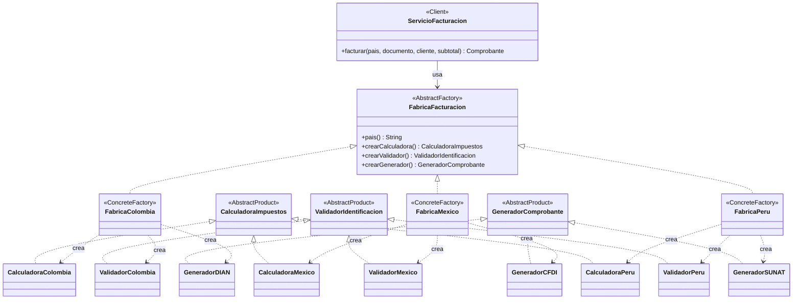

# ShopFlow

Ingeniería de Software 2 · Taller: patrones de diseño creacionales y estructurales en una API REST (Universidad El Bosque, 2026-2).

---

## 1. Integrantes, roles y ejecución del proyecto

### Integrantes y roles

| Rol | Integrante | Patrones (ronda 1 → ronda 2) | Reto de extensión |
|---|---|---|---|
| A | Maryory González Rendón | Builder → Abstract Factory | A · Perú (Abstract Factory) |
| B | Andrés Felipe González  | Adapter → Decorator | B · Métricas (Decorator) |
| C | Juan David González | Proxy → Factory Method | C · WhatsApp (Factory Method) |

Integrador de las ramas: Andrés Felipe González 

### Cómo ejecutar el proyecto

Requisitos: Java 17 o superior y Maven (o un IDE con soporte para Maven).

```bash
mvn spring-boot:run
```

La API queda disponible en `http://localhost:8080`.

Para ejecutar las pruebas unitarias:

```bash
mvn test
```

---

## 2. Tabla de análisis de patrones (Anexo D)

| Patrón | Problema en ShopFlow (síntoma) | Participantes GoF → clases | Principio SOLID | Cuándo no usarlo |
|---|---|---|---|---|
| **Factory Method** | _Pendiente (Rol C)_ | | | |
| **Abstract Factory** | La facturación depende del país. Cada país tiene reglas distintas de impuestos, validación de identificación y comprobante. Con lógica condicional por país (`if`/`switch`), cada país nuevo obliga a modificar el servicio de facturación y se pueden mezclar reglas (por ejemplo, validar un pedido de México con reglas colombianas). | **Abstract Factory:** `FabricaFacturacion`.<br>**Concrete Factory:** `FabricaColombia`, `FabricaMexico`, `FabricaPeru`.<br>**Abstract Products:** `CalculadoraImpuestos`, `ValidadorIdentificacion`, `GeneradorComprobante`.<br>**Concrete Products:** `CalculadoraColombia`, `ValidadorColombia`, `GeneradorDIAN`; `CalculadoraMexico`, `ValidadorMexico`, `GeneradorCFDI`; `CalculadoraPeru`, `ValidadorPeru`, `GeneradorSUNAT`.<br>**Client:** `ServicioFacturacion`. | **OCP:** un país nuevo es una fábrica nueva, sin modificar `ServicioFacturacion`.<br>**DIP:** el servicio depende de la abstracción `FabricaFacturacion`, no de las clases de cada país. | Cuando no hay familias (un solo país) o cuando la familia cambia con frecuencia: agregar un producto nuevo a la familia obliga a modificar la interfaz y todas las fábricas concretas. |
| **Builder** | Un pedido tiene 4 datos obligatorios, al menos un ítem y 6 opciones (dirección, recoger en tienda, cupón, nota de regalo, envío express, canal de notificación), con reglas que dependen unas de otras. Un constructor largo permite confundir el orden de dos `String`; con setters, el pedido existe incompleto y puede quedar inválido. | **Builder:** `Pedido.Builder`.<br>**Product:** `Pedido` (inmutable, constructor privado).<br>**Director:** `PedidoService.crear()`, que traduce el JSON recibido a llamadas al builder. | **SRP:** el producto representa el pedido y el builder se encarga de construirlo y validarlo.<br>**OCP:** agregar una opción nueva no obliga a crear más constructores. | Para objetos con dos o tres parámetros, todos obligatorios: el builder duplica código sin aportar nada y hay que mantenerlo cada vez que cambian los atributos. |
| **Adapter** | _Pendiente (Rol B)_ | | | |
| **Decorator** | _Pendiente (Rol B)_ | | | |
| **Proxy** | _Pendiente (Rol C)_ | | | |

---

## 3. Patrones implementados

### 3.1 Builder

#### Problema que resuelve

Un pedido tiene datos obligatorios (cliente, país, documento, contacto y al menos un ítem) y muchas opciones. Varias reglas dependen de más de una opción a la vez:

- La dirección es obligatoria si el pedido no se recoge en tienda.
- Un pedido para recoger en tienda no puede ser express.
- La nota de regalo admite máximo 140 caracteres.

Con un constructor largo es fácil invertir dos `String`; con setters, el pedido existe incompleto mientras se arma y nadie garantiza las reglas. `Pedido.Builder` concentra todas las validaciones en `build()`, por lo que nunca se entrega un pedido inválido.

#### Participantes GoF

| Participante | Clase | Responsabilidad |
|---|---|---|
| Builder | `Pedido.Builder` | Recibe los datos obligatorios en su constructor, ofrece un método por cada opción (interfaz fluida) y valida en `build()`. |
| Product | `Pedido` | Objeto inmutable: atributos `final`, constructor privado y sin setters. |
| Director | `PedidoService.crear()` | Traduce el `PedidoRequest` recibido a llamadas al builder. |

`ItemPedido` es un `record` (sku, nombre, cantidad y precio unitario). El precio se toma del catálogo, no del cliente. El cupón de prueba `BOSQUE10` aplica 10 % de descuento sobre el subtotal.

#### Diagrama de clases

Insertar diagrama 
#### Endpoint que lo evidencia

```
POST /api/pedidos
GET  /api/pedidos/{id}
```

Ejemplo de petición:

```json
{
  "clienteId": "CLI-001",
  "documentoCliente": "1020304050",
  "pais": "CO",
  "contacto": "ana.perez@correo.com",
  "items": [
    { "sku": "SKU-001", "cantidad": 1 },
    { "sku": "SKU-002", "cantidad": 2 }
  ],
  "direccionEnvio": "Calle 134 # 9-51, Bogotá",
  "cupon": "BOSQUE10",
  "envioExpress": true,
  "canalNotificacion": "EMAIL"
}
```

Respuestas relevantes:

| Caso | Respuesta |
|---|---|
| Pedido válido | `201 Created` con el pedido y el descuento del cupón |
| Pedido sin ítems | `400` con mensaje claro |
| Domicilio sin dirección | `400` con mensaje claro |
| Recoger en tienda y express a la vez | `400` con mensaje claro |
| Nota de regalo de más de 140 caracteres | `400` |
| SKU inexistente | `404` |

Prueba unitaria: `PedidoBuilderTest` (`src/test/java/.../pedidos/`).

---

### 3.2 Abstract Factory

#### Problema que resuelve

Cada país exige una **familia** de piezas que deben ir juntas:

- Calculadora de impuestos.
- Validador de identificación del cliente.
- Generador del comprobante electrónico.

Sin el patrón, `ServicioFacturacion` tendría un `if (pais.equals("CO"))` repetido, sería fácil mezclar el impuesto de un país con el comprobante de otro, y abrir Perú obligaría a editar cada `if`. Con Abstract Factory el servicio recibe `List<FabricaFacturacion>`, arma un mapa por país y factura sin conocer ninguna clase concreta.

| País | Impuesto | Documento del cliente | Comprobante |
|---|---|---|---|
| Colombia (`CO`) | IVA 19 % | Cédula o NIT (6 a 10 dígitos) | Factura electrónica (DIAN) |
| México (`MX`) | IVA 16 % | RFC | CFDI (SAT) |
| Perú (`PE`) | IGV 18 % | RUC de 11 dígitos (el validador también acepta 8 dígitos) | Factura electrónica (SUNAT) |

> Las tarifas y formatos de documento son valores de referencia para el ejercicio, no asesoría tributaria.

#### Participantes GoF

| Participante | Clases |
|---|---|
| Abstract Factory | `FabricaFacturacion` (`pais()`, `crearCalculadora()`, `crearValidador()`, `crearGenerador()`) |
| Concrete Factory | `FabricaColombia`, `FabricaMexico`, `FabricaPeru` (todas `@Component`) |
| Abstract Products | `CalculadoraImpuestos`, `ValidadorIdentificacion`, `GeneradorComprobante` (y el `record Comprobante`) |
| Concrete Products | Colombia: `CalculadoraColombia`, `ValidadorColombia`, `GeneradorDIAN`<br>México: `CalculadoraMexico`, `ValidadorMexico`, `GeneradorCFDI`<br>Perú: `CalculadoraPeru`, `ValidadorPeru`, `GeneradorSUNAT` |
| Client | `ServicioFacturacion` |

#### Diagrama de clases



#### Endpoint que lo evidencia

El comprobante se incluye en la respuesta de:

```
POST /api/pedidos
```

El país se indica con su código en el campo `pais` (`CO`, `MX` o `PE`).

| Pedido | Resultado |
|---|---|
| `"pais": "CO"` con cédula `1020304050` | Factura electrónica (DIAN), IVA 19 % |
| `"pais": "MX"` con RFC `GODE561231GR8` | CFDI (SAT), IVA 16 % |
| `"pais": "MX"` con la cédula colombiana `1020304050` | `400` (documento inválido para MX) |
| `"pais": "PE"` con RUC de 11 dígitos | Factura electrónica (SUNAT), IGV 18 % |

Prueba unitaria: `ServicioFacturacionTest` (`src/test/java/.../facturacion/`).

---

### 3.3 Adapter

_Pendiente (Rol B)._

### 3.4 Decorator

_Pendiente (Rol B)._

### 3.5 Proxy

_Pendiente (Rol C)._

### 3.6 Factory Method

_Pendiente (Rol C)._

---

## 4. Retos de extensión

### Reto A · Perú (Abstract Factory)

El reto consistió en agregar soporte para Perú **sin modificar ninguna clase existente**. Se agregó una familia nueva en `facturacion/peru/`:

```
facturacion/peru/
├── CalculadoraPeru.java
├── FabricaPeru.java
├── GeneradorSUNAT.java
└── ValidadorPeru.java
```

La extensión agrega:

- Cálculo de IGV del 18 %.
- Validación del documento peruano (RUC de 11 dígitos).
- Comprobante electrónico SUNAT.

`FabricaPeru` está anotada con `@Component`, por lo que Spring la inyecta en `List<FabricaFacturacion>` y `ServicioFacturacion` la incorpora a su mapa por país sin cambios.

**Evidencia:** salida de `git diff --stat` del commit del reto (debe mostrar solo archivos nuevos):


mgonz@Compi MINGW64 /d/WorkShopflow/shopflow-base/shopflow-base (main)
$ git diff --stat HEAD~1
 .../shopflow/facturacion/peru/CalculadoraPeru.java | 19 ++++++++++
 .../shopflow/facturacion/peru/FabricaPeru.java     | 41 ++++++++++++++++++++++
 .../shopflow/facturacion/peru/GeneradorSUNAT.java  | 30 ++++++++++++++++
 .../shopflow/facturacion/peru/ValidadorPeru.java   | 21 +++++++++++
 4 files changed, 111 insertions(+)

También se guarda en `evidencias/reto-a-peru.txt`.

### Reto B · Métricas (Decorator)

_Pendiente (Rol B)._

### Reto C · WhatsApp (Factory Method)

_Pendiente (Rol C)._

---

## 5. Preguntas de reflexión

**1. Escriba cómo habría quedado `PedidoService` sin Factory Method ni Abstract Factory: ¿cuántos `if` tendría y qué clases habría que modificar para abrir Perú y agregar WhatsApp?**

_Respuesta pendiente._

**2. ¿Por qué las notificaciones usan Factory Method y la facturación usa Abstract Factory? Responda con la diferencia entre crear un producto y crear una familia de productos.**

_Respuesta pendiente._

**3. Invierta el orden de los decoradores (reintento por fuera de la auditoría) y pague cinco pedidos con LegacyPay. ¿Qué cambia en `GET /api/pagos/auditoria`? ¿Qué orden conviene y por qué?**

_Respuesta pendiente._

**4. `CatalogoCacheProxy` y `AuditoriaPago` tienen casi la misma estructura: implementan la interfaz y envuelven un objeto. ¿Por qué uno es Proxy y el otro Decorator?**

_Respuesta pendiente._

**5. Si otro sistema cambia un precio directamente en el catálogo remoto, ¿qué problema tiene la caché del proxy? Proponga una solución.**

_Respuesta pendiente._

**6. `QuickPayAdapter` convierte `BigDecimal` a `double`. ¿Qué riesgo trae y por qué conviene que esa decisión viva en el adapter y no en el dominio?**

_Respuesta pendiente._

**7. ¿En qué parte del proyecto no convenía aplicar un patrón? Justifique con el criterio «cuándo no usarlo» del Anexo A.**

_Respuesta pendiente._

**8. Para cada patrón, indique el principio SOLID que aplica y cite la clase o la línea de código que lo evidencia.**

_Respuesta pendiente._

---

## 6. Conclusiones del grupo y dificultades encontradas


